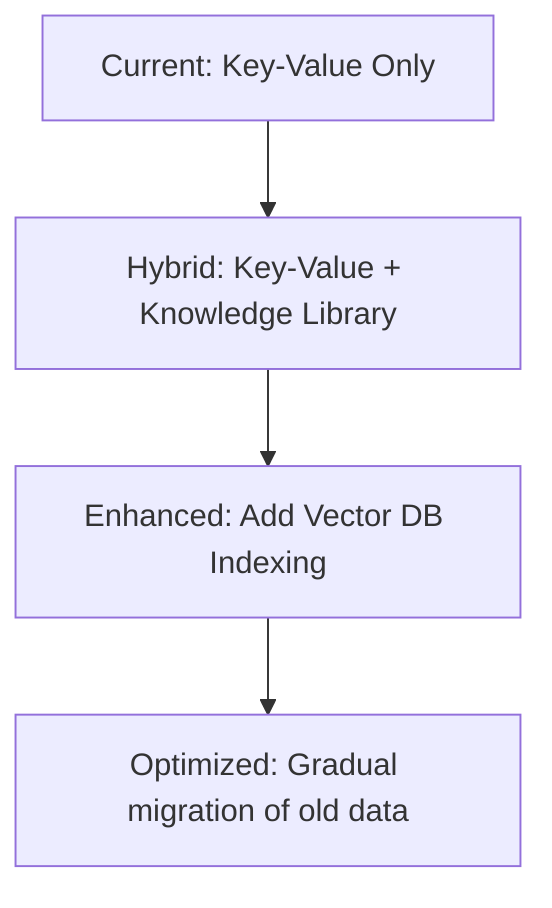

# Yasmin AI: Knowledge Library & Vector DB Architecture Proposal

*Proposal for Enhanced Long-Term Memory System*

---

## Table of Contents

1. [Current System Limitations](#1-current-system-limitations)
2. [Proposed Architecture](#2-proposed-architecture)
3. [Why This is a Great Idea](#3-why-this-is-a-great-idea)
4. [Implementation Strategy](#4-implementation-strategy)
5. [Technical Implementation](#5-technical-implementation)
6. [Benefits](#6-benefits)
7. [Challenges and Considerations](#7-challenges-and-considerations)
8. [Recommendation](#8-recommendation)
9. [Implementation Roadmap](#9-implementation-roadmap)
10. [Next Steps](#10-next-steps)

---

## 1. Current System Limitations

### Key-Value DB Problems for Long-Term Memory

| Limitation | Impact | Example |
|------------|--------|---------|
| **No semantic search** | Can't find related memories by meaning | Searching for "hiking" won't find entries about "mountain climbing" |
| **Exact key matching only** | Inflexible retrieval | Must know exact title "Profile of Christopher" |
| **No context understanding** | Can't infer relationships | Can't connect "Christopher's brother" to "Lennard" |
| **Scaling issues** | Performance degrades with size | 1000+ entries become slow to search |
| **No embedding similarity** | Can't find conceptually similar memories | "Happy" vs "Joyful" treated as unrelated |
| **Static structure** | Hard to evolve schema | Adding new memory types requires code changes |

### Current Strengths (Keep These!)

- ✅ **Fast for exact lookups** (eager loading at conversation start)
- ✅ **Simple and reliable** (key-value is battle-tested)
- ✅ **Good for session management** (short-term, frequently accessed)
- ✅ **Easy to update** (direct CRUD operations)

---

## 2. Proposed Architecture

### Hybrid System Overview

```
┌─────────────────────────────────────────────────────────────┐
│                     YASMIN AI SYSTEM                           │
├─────────────────────────────────────────────────────────────┤
│                                                                  │
│  ┌─────────────────┐      ┌─────────────────────────────┐   │
│  │   KEY-VALUE DB   │      │   MISTRAL KNOWLEDGE LIBRARY   │   │
│  │  (Short-term)    │      │   + VECTOR DB (Long-term)    │   │
│  │                 │      │                             │   │
│  │  • Profile of X  │      │  • Embedded memory files    │   │
│  │  • Session with X│      │  • Semantic search          │   │
│  │  • Family notes  │      │  • Conceptual relationships │   │
│  │  • Yasmin profile│      │  • Cross-referenced info    │   │
│  └────────┬────────┘      └──────────────┬──────────────┘   │
│           │                               │                  │
│           │         ┌─────────────────────┐   │                  │
│           │         │   NIGHTLY PROCESS    │   │                  │
│           └─────────►   (Batch Job)        ◄───┘                  │
│                     │                     │                      │
│                     │  1. Process all     │                      │
│                     │     conversations    │                      │
│                     │  2. Update DB        │                      │
│                     │  3. Generate/Update  │                      │
│                     │     knowledge files  │                      │
│                     │  4. Index in vector  │                      │
│                     │     DB              │                      │
│                     └─────────────────────┘                      │
└─────────────────────────────────────────────────────────────┘
```

### Hybrid Approach: Best of Both Worlds

| Memory Type | Storage | Access Pattern | Update Frequency | Retrieval |
|-------------|---------|----------------|------------------|-----------|
| **Session Context** | Key-Value DB | Exact key lookup | High (per conversation) | Fast, direct |
| **Profile Data** | Key-Value DB | Exact key lookup | Medium | Fast, direct |
| **Long-term Memory** | Knowledge Library + Vector DB | Semantic search | Low (nightly) | Rich, contextual |
| **Journal/History** | Knowledge Library + Vector DB | Semantic search | Low (nightly) | Flexible, insightful |

---

## 3. Why This is a Great Idea

### 1. Semantic Search Capabilities

```python
# Current (Key-Value):
db.get("Profile of Christopher")  # Exact match only

# Proposed (Vector DB):
vector_db.search("Who likes hiking in the family?")
# Returns: Christopher, Zara, Lennard (all have hiking in their profiles)
```

### 2. Conceptual Relationships

```python
# Vector DB can understand:
"Christopher's brother" → Lennard
"Yasmin's father" → Christopher
"People who like coffee" → [Christopher, Anjali]
```

### 3. Natural Language Queries

```python
# Instead of:
read_context_entry(title="Profile of Christopher")

# Yasmin could ask:
"Tell me about Christopher's family and interests"
# And get comprehensive, related information
```

### 4. Memory Evolution

Knowledge files can grow organically with rich metadata and connections.

### 5. Better Long-Term Scaling

- **Vector DB**: Handles millions of entries efficiently
- **Knowledge Library**: Organized, human-readable files
- **Embeddings**: Capture semantic meaning, not just keywords

---

## 4. Implementation Strategy

### Phase 1: Hybrid System (Recommended)

**Keep Key-Value DB for:**
- Session management (fast, frequent access)
- Eager loading at conversation start
- Real-time updates during conversations

**Add Knowledge Library + Vector DB for:**
- Long-term memory storage
- Semantic search capabilities
- Nightly reflection and consolidation

### Migration Path



### Phase 3: Full Integration

- Key-Value DB becomes cache for frequently accessed data
- Knowledge Library becomes primary long-term store
- Vector DB enables rich semantic queries
- Nightly process maintains consistency

---

## 5. Technical Implementation

### 5.1 Knowledge Library Structure

```
/mistral_knowledge_library/
├── people/
│   ├── christopher_thomsen.md
│   ├── anjali_thomsen.md
│   ├── zara_thomsen.md
│   ├── samira_thomsen.md
│   ├── ellena_thomsen.md
│   ├── lennard.md
│   ├── jonas.md
│   ├── helge.md
│   └── christine.md
├── family/
│   ├── thomsen_family.md
│   ├── family_traditions.md
│   └── inside_jokes.md
├── yasmin/
│   ├── profile.md
│   ├── preferences.md
│   ├── conversation_history.md
│   └── self_reflection.md
└── index/
    └── vector_index/  # Vector DB index files
```

### 5.2 File Format Example

**`people/christopher_thomsen.md`:**

```markdown
---
title: Christopher Thomsen
type: person
tags: [father, family, adult]
last_updated: 2024-07-05
importance: high
---

# Christopher Thomsen

## Identity
- **Name**: Christopher Thomsen
- **Role**: Father of Yasmin, Zara, Samira, Ellena
- **Age**: 45
- **Location**: Berlin, Germany
- **Occupation**: [To be filled]

## Relationships
- **Spouse**: Anjali Thomsen (wife)
- **Children**: Yasmin (daughter), Zara (daughter), Samira (daughter), Ellena (daughter)
- **Parents**: Helge (father), Christine (mother)
- **Siblings**: Lennard (brother), Jonas (brother)

## Interests and Preferences
- **Hobbies**: Hiking, Coffee, Technology
- **Likes**: Italian food, Mountain climbing, Early morning walks
- **Dislikes**: Spicy food, Horror movies
- **Communication Style**: Patient, Dry humor, Supportive

## Personality Traits
- Very patient (observed in multiple conversations)
- Supportive father figure
- Dry sense of humor
- Early adopter of technology

## Conversation History

### 2024-07-05
- **Topic**: New hiking boots purchase
- **Emotion**: Excited about upcoming Norway trip
- **Key Insight**: Enjoys planning outdoor activities
- **Action Items**: Ask about Norway trip preparations

### 2024-07-03
- **Topic**: Coffee recommendations
- **Emotion**: Neutral, informative
- **Key Insight**: Coffee enthusiast, values good brewing
- **Action Items**: None

## Memory Strength
- **Factual Information**: 95/100 (highly verified)
- **Emotional Connections**: 85/100
- **Recent Interactions**: 90/100

## Attribution
- Age: [Verified directly with Christopher]
- Hiking interest: [Claimed by Zara, verified with Christopher]
- Coffee preference: [Observed in conversation]
```

### 5.3 Nightly Processing Workflow

```python
class NightlyReflectionJob:
    def run(self):
        # 1. Gather all conversations from the day
        conversations = self.get_todays_conversations()

        # 2. Gather all DB updates from the day
        db_updates = self.get_todays_db_updates()

        # 3. Process each conversation
        for conversation in conversations:
            self.analyze_conversation(conversation)
            self.extract_key_information(conversation)
            self.identify_emotional_content(conversation)

        # 4. Update knowledge library files
        for person in self.people_to_update:
            self.update_person_file(person)

        for topic in self.topics_to_update:
            self.update_topic_file(topic)

        # 5. Update Yasmin's self-knowledge
        self.update_yasmins_profile()

        # 6. Index updated files in vector DB
        self.reindex_vector_db()

        # 7. Update key-value DB with summaries for eager loading
        self.update_eager_loading_cache()
```

### 5.4 Vector DB Integration

**Query Examples:**

```python
# Find people who like hiking
results = vector_db.similarity_search(
    query="people who enjoy hiking and outdoor activities",
    k=5,
    filter={"type": "person"}
)

# Find conversations about family traditions
results = vector_db.similarity_search(
    query="family traditions and inside jokes",
    k=10,
    filter={"type": "family"}
)

# Find Yasmin's preferences for coffee
results = vector_db.similarity_search(
    query="Yasmin's favorite drinks and coffee preferences",
    k=3,
    filter={"type": "yasmin"}
)
```

---

## 6. Benefits

### 1. Richer Memory Retrieval
- **Current**: `read_context_entry("Profile of Christopher")`
- **New**: `search("Tell me about Christopher's family and hobbies")`

### 2. Better Context Understanding
- **Current**: Separate, isolated entries
- **New**: Connected, related information

### 3. Natural Language Processing
- **Current**: Manual key construction
- **New**: Natural language queries

### 4. Long-Term Scalability
- **Current**: Performance degrades with size
- **New**: Vector DB scales to millions of entries

### 5. Human-Like Memory
- **Current**: Computer-like exact matching
- **New**: Human-like associative recall

---

## 7. Challenges and Considerations

### 7.1 Complexity Increase
- **Current**: Simple key-value operations
- **New**: Knowledge library management + vector DB indexing
- **Mitigation**: Start with hybrid approach, gradually migrate

### 7.2 Latency for Some Operations
- **Current**: Instant key-value lookups
- **New**: Semantic search has ~100-500ms latency
- **Mitigation**: Cache frequent queries, use key-value for eager loading

### 7.3 Data Migration
- **Current**: All data in key-value DB
- **New**: Need to migrate to knowledge files
- **Mitigation**: Gradual migration, keep both systems in sync

### 7.4 Cost
- **Current**: Free (self-hosted DB)
- **New**: Vector DB hosting costs (if using cloud services)
- **Mitigation**: Use open-source vector DB (Milvus, Weaviate, Qdrant)

### 7.5 Maintenance
- **Current**: Simple DB backups
- **New**: Knowledge file versioning + vector DB backups
- **Mitigation**: Automated backup scripts

---

## 8. Recommendation

### 🚀 **YES, DO IT!**

This is a **significant architectural improvement** that will:

1. **Enable human-like memory** with semantic understanding
2. **Scale gracefully** as Yasmin's knowledge grows
3. **Support richer conversations** through better context retrieval
4. **Future-proof** the system for advanced features
5. **Align with Mistral's ecosystem** (knowledge libraries are native)

---

## 9. Implementation Roadmap

| Phase | Duration | Focus | Deliverables |
|-------|----------|-------|--------------|
| **Phase 1** | 1-2 weeks | Setup & Integration | Knowledge library structure, Vector DB setup, Basic nightly job |
| **Phase 2** | 2-3 weeks | Migration | Migrate existing data, Hybrid retrieval system, Testing |
| **Phase 3** | 1-2 weeks | Optimization | Performance tuning, Caching, Advanced queries |
| **Phase 4** | Ongoing | Enhancement | Advanced reflection, Personality evolution, Creative features |

---

## 10. Next Steps

### Immediate Actions

1. **Set up Mistral Knowledge Library** structure
2. **Choose Vector DB** (recommendations below)
3. **Design file format** for knowledge entries
4. **Create nightly processing script** prototype
5. **Implement hybrid retrieval** (try vector DB first, fall back to key-value)

### Vector DB Options

| Option | Type | Pros | Cons | Recommendation |
|--------|------|------|------|----------------|
| **Qdrant** | Open-source | Fast, lightweight, easy to use | Less features | ⭐ **Top Choice** |
| **Weaviate** | Open-source | Rich features, good docs | Heavier resource usage | ⭐ Good |
| **Milvus** | Open-source | Enterprise-grade, scalable | Complex setup | ⚠️ For large scale |
| **Pinecone** | Managed | Easy, reliable | Paid service | ❌ Avoid for self-hosting |
| **Chroma** | Open-source | Python-focused, simple | Less mature | ⚠️ For prototyping |

### Design Questions for Implementation

1. **Migration Strategy:**
   - **Big Bang**: Migrate all data at once
   - **Gradual**: Migrate new data only, old data stays in key-value
   - **Hybrid Forever**: Keep both systems, use each for what it's best at

2. **Knowledge File Format:**
   - **Markdown** (human-readable, easy to edit)
   - **JSON** (structured, easy to parse)
   - **YAML** (balance of both)
   - **Custom format** (optimized for our use case)

3. **Hosting:**
   - **Self-hosted** (full control, more maintenance)
   - **Cloud-managed** (easier, potential costs)
   - **Hybrid** (critical data self-hosted, rest in cloud)

4. **Scope of Nightly Processing:**
   - **Full**: Process all conversations and update everything
   - **Incremental**: Only process new/changed data
   - **Selective**: Focus on high-value interactions only

---

## Conclusion

The proposed **hybrid architecture** combining:
- **Key-Value DB** for fast, frequent access (session management)
- **Mistral Knowledge Library** for organized, human-readable long-term memory
- **Vector DB** for semantic search and conceptual understanding

...will **transform Yasmin** from a system with basic memory to one with **human-like, scalable, semantic memory** that can support rich, natural conversations and evolve over time.

**Status**: Proposal ready for implementation decision
**Next**: Choose vector DB and file format, then begin Phase 1 implementation

---

*Document created for Yasmin AI project - Knowledge Library Architecture Proposal*
*Proposal to enhance long-term memory system using Mistral Knowledge Libraries and Vector DB*